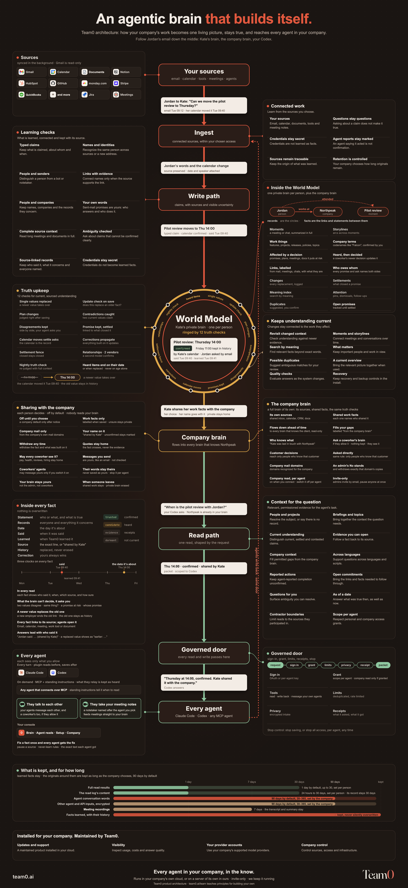

# Agentic brain design - the /learn companion skill

Build, review and measure your own agentic brain with your agent, using the principles in the [Team0 /learn series](https://team0.ai/learn). Works with MD files, databases, knowledge graphs and existing memory products. Includes implementation exercises, design questions and a scoring tool with synthetic examples.

[](assets/team0-agentic-brain-public.pdf)

The poster shows **Team0's company product**. The skill helps you apply the underlying principles to your own implementation; it does not install or reproduce the full system shown. [Download the poster PDF](assets/team0-agentic-brain-public.pdf) · [Explore the architecture](https://team0.ai/world-model/architecture). Poster © Team0, share unchanged with attribution; see [poster license](assets/LICENSE).

## Use it

Run this command inside the project where you want to use the skill:

```bash
npx skills add Team0-ai/agentic-brain-design
```

Or copy `agentic-brain-design/` into the skills folder your agent supports. The skill consults the relevant full /learn article alongside its bundled notes, then helps explain, implement, review or measure your setup. It reads the parts needed for the task. Example requests:

- “Walk me through part 1 using my existing Markdown memory.”
- “Help me implement the changed-date exercise in part 3.”
- “Compare my MD memory with this database setup on the same questions.”
- “Review what happens when an employee loses access.”

## Measure before building

The scorer reads saved agent answers; it does not connect to memory products. It judges current correctness, relevance, omissions, ordering and context completeness using the same rubric for every storage format. A good MD-based setup can outperform a database or graph.

Validate the worked example without a key or a paid model call:

```bash
python3 agentic-brain-design/scripts/score.py agentic-brain-design/scripts/examples/questions.jsonl agentic-brain-design/scripts/examples/before.jsonl --dry-run
```

For live scoring, install `anthropic>=2.3,<3` and `pydantic>=2,<3`, set `ANTHROPIC_API_KEY` in your environment and follow `agentic-brain-design/references/part-0-test-set.md`. Questions, expected truth and answers are sent to Anthropic and incur charges. Use synthetic/redacted data or the necessary permission. Keep answer keys away from the agent being tested, preserve comparable test conditions and check the judge against human labels. Access and privacy need separate checks.

## Building independently or buying a company install

The lessons and skill help you build your own system. They teach choices, examples and tests rather than a copy of Team0's production implementation.

For a maintained company brain, [Team0 supplies an install in your cloud, with updates and support](https://team0.ai/product?utm_source=github&utm_medium=skill&utm_campaign=learn). Your company controls its infrastructure and provider accounts. [Talk about a company install](https://calendar.app.google/uM9ptyv83Ubgnq226).

By [Yogev Ben-Tov](https://www.linkedin.com/in/ybentov/), founder of [Team0](https://team0.ai). Skill instructions and code are MIT licensed; see [LICENSE](LICENSE). The poster has its own [CC BY-ND 4.0 license](assets/LICENSE).
